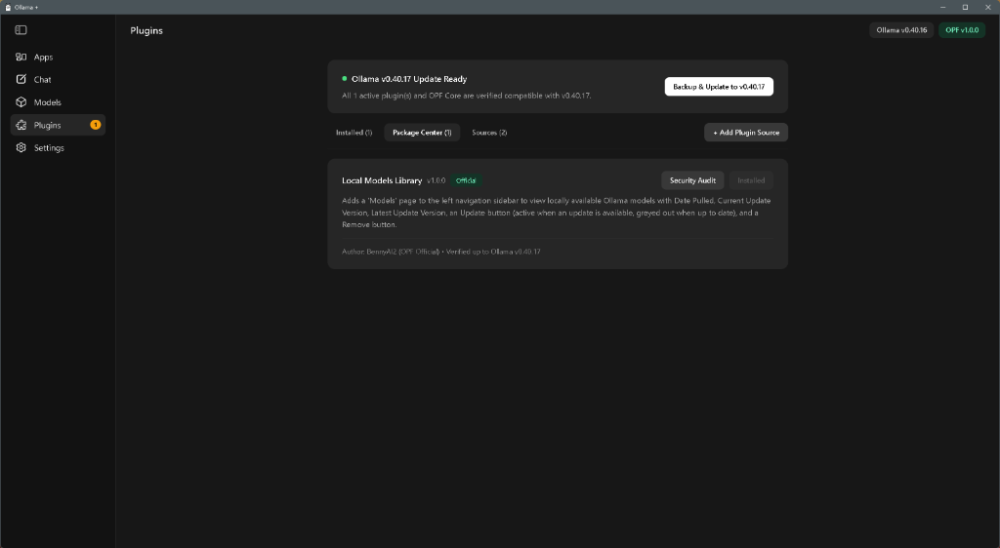
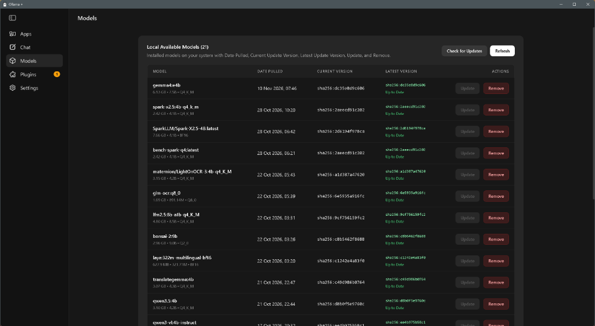
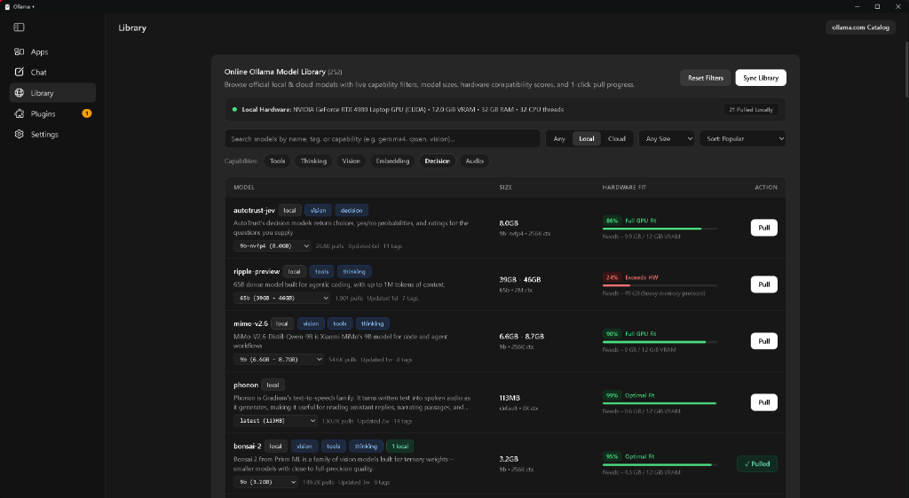
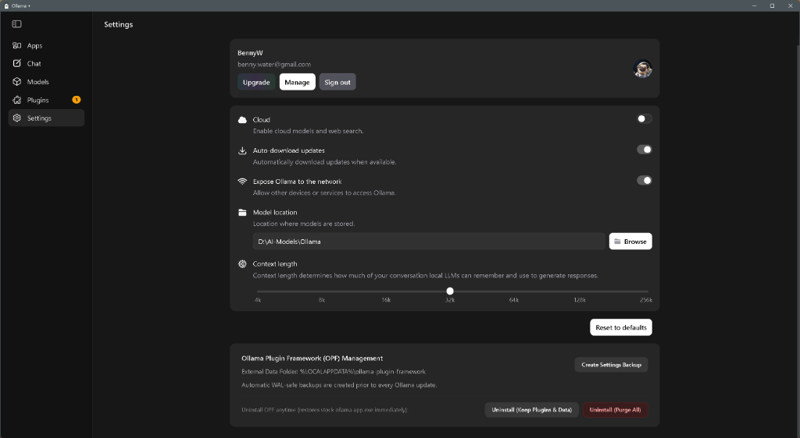

# Ollama Plugin Framework (OPF) — Official Plugin Source Repository

> ### 🚀 Coming Soon: Ollama Plugin Framework (`Ollama +`) Desktop Release
> The **Ollama Plugin Framework (`Ollama +`)** desktop integration and one-click installer are currently in final preparation and **coming soon**!
> When loaded, **Ollama +** extends the native Ollama desktop experience with a dedicated **Plugins** manager, customizable repository sources, automated version-compatibility gating, and standardized native UI components—while shipping with **0 pre-installed plugins** so you stay in complete control of what runs on your system.

Official and Community-Endorsed plugin registry for the **Ollama Plugin Framework (OPF)**.

OPF ships with **Zero Default Bloat** (0 pre-installed plugins) and uses a **Multi-Source Package Center Architecture** combined with a **Version-Verified Plugin Compatibility Update Gate**.

---

## 📸 Preview & Screenshots

### 1. Ollama + Plugins Manager & Package Center

*Dedicated **Plugins** navigation entry with compatibility update alerts, Package Center browser, and custom repository sources.*

### 2. Local Models Library Plugin (Installed via Package Center)

*Dynamically registered **Models** sidebar view with Date Pulled, Current/Latest Version digest tracking, Update action, and model deletion.*

### 3. Ollama Library Explorer Plugin (Installed via Package Center)

*Dynamically registered **Library** view mirroring the online Ollama catalog with Local/Cloud & capability filters, model sizes, live hardware compatibility scoring, pull progress %, and pulled indicators.*

### 4. Integrated OPF Settings Management

*Native Ollama Settings integration with automatic snapshot backups and one-click uninstall/restore options.*

---

## 📦 Live Source Manifest URLs

Add or manage these sources inside the **Ollama +** Desktop **`Plugins -> Sources`** tab:

| Source Tier | Manifest URL |
| :--- | :--- |
| **OPF Official Plugins** (`opf-official`) | `https://raw.githubusercontent.com/BennyAI2/Ollama-Plugin-Framework-Official-Plugin-Repo/main/official-source.json` |
| **OPF Endorsed Community** (`opf-endorsed`) | `https://raw.githubusercontent.com/BennyAI2/Ollama-Plugin-Framework-Official-Plugin-Repo/main/community-endorsed.json` |

---

## 🧩 Available Plugins

### 1. Local Models Library (`com.opf.local-models-manager`)
- **Tier**: `official`
- **Version**: `1.0.0`
- **Navigation**: Adds a **`Models`** item directly to the left-hand navigation sidebar (`Apps`, `Chat`, `Models`, `Plugins`, `Settings`) when installed and enabled.
- **Capabilities**:
  - Queries locally available Ollama models (`/api/tags`) and displays each model's **Name & Quantization/Size**, **Date Pulled**, **Current Update Version** (digest), and **Latest Update Version**.
  - **Update Button**: Active & clickable when a model update is available (triggers `POST /api/pull` with live progress); greyed out (`disabled`) when the local model is already up to date.
  - **Remove Button**: Removes a local model via `DELETE /api/delete` with inline confirmation.

### 2. Ollama Library Explorer (`com.opf.ollama-library-explorer`)
- **Tier**: `official`
- **Version**: `1.0.0`
- **Navigation**: Adds a **`Library`** item directly to the left-hand navigation sidebar when installed and enabled.
- **Capabilities**:
  - Displays the full online Ollama model library ([`catalog/ollama-library.json`](catalog/ollama-library.json), automatically synced from `https://ollama.com/search` and merged live with `/api/v1/models/cloud`).
  - **Filters**: Search bar, **Any / Local / Cloud** locality switch, multi-select capability filters (`Tools`, `Thinking`, `Vision`, `Embedding`, `Decision`, `Audio`), download size buckets (`Up to 8 GB` through `Over 64 GB`), and sorting (`Popular`, `Best Hardware Fit`, `Smallest Size`, `Context Window`, `Newest`, `Name`).
  - **Model Size & Variant Selector**: Displays downloadable GB/MB size (or Cloud status) and lets you inspect specific tags per model family.
  - **Local Hardware Compatibility Score**: Evaluates each model tag's estimated VRAM/memory requirement against your detected GPU VRAM and system memory (`/api/v1/inference-compute` + WebGL/WebGPU + RAM).
  - **Inline Pull Progress & Pulled Replacement Button**: Initiating `POST /api/pull` replaces the `Pull` button in the table row with a live percentage progress indicator (`Pulling XX%`); models already available locally (`/api/tags`) hide the `Pull` button and show a **`✓ Pulled`** replacement button instead.

---

## 🛡️ Version-Verified Compatibility Gate & Automated CI

1. **Git-Diff Smart Version Bumper ([`.github/workflows/ollama-release-watcher.yml`](.github/workflows/ollama-release-watcher.yml))**:
   - Checks new releases of `ollama/ollama` against each plugin's declared `watch_paths` (`api/types.go`, `server/routes.go`).
   - Automatically bumps `verified_ollama_versions` and `max_tested_ollama_version` when a plugin's watched paths are untouched.

2. **Dual Frontier AI & Static AST Security Auditor ([`.github/workflows/plugin-security-audit.yml`](.github/workflows/plugin-security-audit.yml))**:
   - Audits every PR and commit via [`scripts/ai-security-auditor.js`](scripts/ai-security-auditor.js).
   - Enforces the **OPF Privacy Airlock** (blocks any access to `~/.ollama/id_ed25519` or SSH keys) and verifies SHA-256 content hashes.
